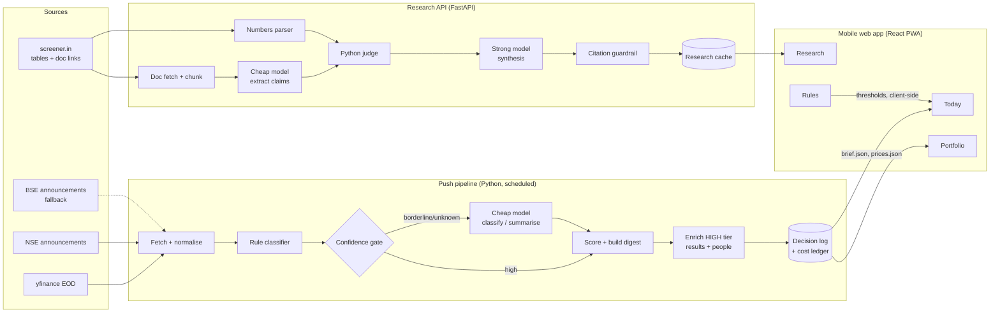

# FINN — the investor agent that tells you what changed

> **Mobile-first financial investment agent for ENAM Holdings' AI Engineer Build Challenge.**
> FINN watches a portfolio of NSE-listed companies, speaks up only when something matters, and backs every number it shows with the exact line of the filing, annual report or transcript it came from.

| | |
|---|---|
| **Live prototype** | `https://finn-<name>.vercel.app` *(open on a phone; installable as an app)* |
| **Research API** | `https://finn-api.onrender.com/docs` |
| **Author** | Gaurav Kumar · IIT Kanpur · gauravkr23@iitk.ac.in |
| **Status** | Prototype built and tested offline (40 tests). Live data: run the pipeline, see [Running it locally](#19-running-it-locally) |

<!-- Demo media goes here once the app exists: 3 phone screenshots or a 10-s GIF showing
     (1) Opening Brief with a Results card, (2) Sources drawer with highlighted quote,
     (3) Promise Ledger with ✅/❌ verdicts. -->

---

## Table of contents

1. [The point of view](#1-the-point-of-view)
2. [What FINN does, in one minute](#2-what-finn-does-in-one-minute)
3. [The investor's day with FINN](#3-the-investors-day-with-finn)
4. [Screens](#4-screens)
5. [Push: how FINN decides what matters](#5-push-how-finn-decides-what-matters)
6. [Push: card treatments for every announcement type](#6-push-card-treatments-for-every-announcement-type)
7. [Pull: research grounded only in primary sources](#7-pull-research-grounded-only-in-primary-sources)
8. [The Promise Ledger (numbers vs. narrative)](#8-the-promise-ledger-numbers-vs-narrative)
9. [Architecture](#9-architecture)
10. [Model routing and cost](#10-model-routing-and-cost)
11. [Trust layer: validation, citations, provenance](#11-trust-layer-validation-citations-provenance)
12. [Data sources and fallbacks](#12-data-sources-and-fallbacks)
13. [Reliability: a demo that cannot break](#13-reliability-a-demo-that-cannot-break)
14. [Tech stack](#14-tech-stack)
15. [Repository structure](#15-repository-structure)
16. [Data contracts](#16-data-contracts)
17. [API](#17-api)
18. [Configuration](#18-configuration)
19. [Running it locally](#19-running-it-locally)
20. [Portfolio and research demo set](#20-portfolio-and-research-demo-set)
21. [Build plan (2 days)](#21-build-plan-2-days)
22. [Key decisions and trade-offs](#22-key-decisions-and-trade-offs)
23. [What I deliberately left out](#23-what-i-deliberately-left-out)
24. [Where I'd take it next](#24-where-id-take-it-next)
25. [Risks and mitigations](#25-risks-and-mitigations)
26. [Mapping to the brief](#26-mapping-to-the-brief)
27. [Patterns carried over from my earlier work](#27-patterns-carried-over-from-my-earlier-work)
28. [AI build history](#28-ai-build-history)

---

## 1. The point of view

An investor's problem is not a lack of information. On a normal day, a 20-stock portfolio generates dozens of exchange filings, and during results season, well over a hundred. Most are compliance paperwork. A handful can change an investment thesis.

So FINN is built around three principles. Every design decision in this document traces back to one of them.

**Principle 1 — Rhythm, not a feed.**
An investor shouldn't have to keep checking an app. FINN speaks at two natural moments of the market day:

- **Opening Brief (≈ 8:30 AM IST):** everything filed since yesterday's close, ranked.
- **Closing Bell (≈ 4:00 PM IST):** unusual price and volume moves once end-of-day data is in, plus filings from the trading day.

Between those, FINN stays silent unless something crosses a threshold *the investor* has set.

**Principle 2 — Every item answers three questions.**
*What happened? Why does it matter to my portfolio? What should I check?* Anything that cannot answer the second question is collapsed out of sight.

**Principle 3 — Every number is traceable.**
Tap any figure and FINN shows the source: the filing, the page, the sentence. If FINN cannot verify a number against its source, it says so instead of guessing. This is how the product avoids "AI slop" by construction rather than by polish.

---

## 2. What FINN does, in one minute

**Push — FINN comes to you**

- A **windowed digest** of every corporate announcement across the portfolio (24h by default; 3 days, 1 week or custom), sorted by a transparent priority score, with routine filings collapsed into a single line.
- **Triggered alerts** for material announcement types the investor chooses, and for unusual end-of-day moves (volume > N× its 20-day average, price beyond ±X%), with **live sliders** that recompute alerts instantly.
- **Rich cards** for the items that matter most:
  - **Results card:** Revenue, EBITDA, PBT, PAT this quarter vs. last quarter (QoQ) and vs. the same quarter last year (YoY), extracted from the actual results filing and sanity-checked.
  - **People card:** for management changes, who the incoming person is and where they came from, taken first from the filing's own appointee profile.
  - **Move card:** an unusual price/volume move, with any same-day filing linked as a possible explanation.
  - **One-liner cards** for mid-priority items; everything routine is hidden but one tap away.

**Pull — you ask FINN to dig in**

For **any NSE ticker** (not hard-wired to the demo set), FINN builds a research view from annual reports and earnings-call transcripts only:

- **Snapshot:** what the company does, segments, headline numbers.
- **Trajectory and cash quality:** multi-year revenue, margins, PAT and cash conversion, with automatic red flags.
- **The Promise Ledger:** what management guided in each of the last four concalls, and what was actually delivered — ✅ Kept, ⚠️ Partly, ❌ Missed, ⏳ Pending — each with the original quote.
- **Bull vs. Bear:** three tight points each way, every point cited.

---

## 3. The investor's day with FINN

```
 08:30  ── Opening Brief ─────────────────────────────────────────
         "3 things need your attention · 21 routine filings hidden"
          1. TITAN — Q2 results: Revenue +18% YoY, PAT +9% YoY, margin −80 bps
          2. POLYCAB — CFO resigns; successor joins from <company>, 20 yrs in finance
          3. KPITTECH — Board approves acquisition of <target>

 11:10  ── Alert (material type you follow) ──────────────────────
          DIXON — Credit rating upgraded to AA+

 16:05  ── Closing Bell ──────────────────────────────────────────
          CDSL — Volume 3.1× 20-day avg · Price −6.4%
                 Same-day filing: "Clarification on news item"  →

 Anytime ── Research ─────────────────────────────────────────────
          "Has ASIANPAINT delivered what it promised?"  → Promise Ledger
```

*(Company details above are placeholders illustrating the format; the live app shows real filings.)*

---

## 4. Screens

Five screens, designed for one thumb on a 380-px-wide phone.

### 4.1 Today (home)

```
┌──────────────────────────────────┐
│ FINN            Opening Brief ▾  │
│ Tue, 3 Nov · since yesterday 3:30│
│ [▶ Listen 45s]   [List | Stack]  │
│ [24h] [3d] [1w] [Custom]         │
├──────────────────────────────────┤
│ NIFTY 24,610 ▲0.4%  VIX 13.2     │  ← context strip
├──────────────────────────────────┤
│ 3 things need your attention     │
│ ┌──────────────────────────────┐ │
│ │ ● RESULTS · TITAN     HIGH   │ │
│ │ Rev  +18% YoY   +6% QoQ      │ │
│ │ PAT  + 9% YoY   −2% QoQ      │ │
│ │ EBITDA margin −80 bps YoY    │ │
│ │ Why: 8% of portfolio      ⓘ  │ │
│ └──────────────────────────────┘ │
│ ┌──────────────────────────────┐ │
│ │ ● PEOPLE · POLYCAB    HIGH   │ │
│ │ CFO resigns → successor named│ │
│ └──────────────────────────────┘ │
│  …                               │
│ ▸ 21 routine filings hidden      │
├──────────────────────────────────┤
│  Today  Portfolio  Research  ⚙   │
└──────────────────────────────────┘
```

**▶ Listen.** A pill at the top reads a short spoken brief (the `spoken_brief` field in `brief.json`) using the browser's built-in speech engine, preferring an Indian English voice. The pipeline writes this script separately from the card text, with units and percentages spelled out ("Titan's revenue grew eighteen percent year on year"), so it sounds natural instead of reading symbols. Zero cost, and it starts only on tap, which mobile browsers require anyway.

**Triage mode (List | Stack).** For the 3–5 Critical and High items, the investor can switch from the list to a card stack and clear the morning in under a minute: **swipe right = Track** (pin and dig deeper), **swipe left = Done**, **tap = flip to sources**. Explicit Track / Done buttons sit under the card as well, so it works for people who don't swipe and avoids conflicts with the browser's edge-swipe gestures. The list stays the default; the stack is a ritual for people who want one.

### 4.2 Card detail

The full card: the extracted table, the "why it matters" line, a **Sources** drawer, a link to the original PDF on NSE, and the cost and model used to produce the card.

**Tap-to-highlight sources.** Tapping a quoted claim opens a bottom drawer showing the **surrounding paragraph from the source with the exact quote highlighted**, plus document name and page. Tapping a results figure shows "✓ matched in filing, p. 3" when the number was found in the filing's text layer. The highlighting comes from the same step that verifies citations (§11), so it costs nothing extra.

### 4.3 Portfolio

All 15–20 holdings as compact rows with live badges (`Results out`, `Vol 2.4×`, `CFO change`, `Pledge ↑`). Tapping a stock opens its 30-day event timeline: every filing and every alert in one vertical line, so the investor sees the story of the stock rather than isolated events.

### 4.4 Research

A single search box: "Any NSE ticker". While FINN works, a step-by-step progress view shows what it is reading ("Fetching 4 concall transcripts → Extracting guidance → Matching against reported numbers"). The result is a scrollable report with sticky section tabs: **Snapshot · Trajectory · Cash · Promises · Bull/Bear**.

Because ENAM may test a company I didn't pick, the screen offers **🎲 Try a live ticker** pills: three non-portfolio tickers that were tested end to end, passed every guardrail, and were then cleared from the cache before submission, so tapping one runs the real live pipeline rather than replaying a stored result. The free-text box accepts any other NSE symbol.

### 4.5 Rules

Where the investor defines what "unusual" means:

- **Volume multiple** slider (1.5× – 5×, default 2×)
- **Price move** slider (±2% – ±10%, default ±4%)
- **Lookback** for the average (10 / 20 / 50 days)
- **Category toggles** for alerts (results, M&A, management change, litigation, pledging…)
- **Mute** list for individual stocks

Moving a slider recomputes the alert list *in the browser*, instantly, with a live count: "At 2.5×, 4 alerts in the last 30 days." The investor sees the consequence of their threshold before committing to it.

### 4.6 How it works (architecture page)

An in-app page that shows the pipeline and the **cost ledger** for the latest run: how many filings were classified by rules, how many needed a model, which model, and the total cost. This makes the efficiency story visible to the reviewer, not just claimed.

---

## 5. Push: how FINN decides what matters

### 5.1 The triage pipeline

FINN triages announcements in layers, the same pattern as a trading signal funnel: cheap, deterministic layers first; models only where they add something.

```
 raw filings
     │
     ▼
 L1  Normalise        dedupe, IST timestamps, map symbol → portfolio
     │
     ▼
 L2  Rule classifier  subject-line + description keywords → 17 categories
     │                 + confidence (high / borderline / unknown)
     ▼
 L3  Confidence gate  high       → keep rule label (no model call)
     │                 borderline → cheap model decides
     │                 unknown    → cheap model classifies
     ▼
 L4  Materiality      category base weight × modifiers (see 5.3)
     │
     ▼
 L5  Enrichment       only for HIGH tier: results extraction, people card,
     │                 one-line summary for MEDIUM tier
     ▼
 L6  Digest builder   rank, group routine, write brief JSON + cost ledger
```

Every layer writes its decision to a **decision log** (one JSON record per filing, per layer). The card's "Why is this here?" button reads straight from that log.

### 5.2 Priority tiers

Built on the 17 categories from ENAM's reference document.

| Tier | Categories | Default treatment |
|---|---|---|
| **Critical** | results, M&A, management_change (CEO/CFO/MD), litigation (regulatory orders, insolvency), pledging (increase) | Top of brief, rich card, eligible for alerts |
| **High** | fund_raise, credit_rating (upgrade/downgrade), capex, insider_trading (promoter), management_change (other KMP) | Rich or one-liner card, eligible for alerts |
| **Medium** | press_release (order wins, launches), dividend, bonus_split, earnings_call (transcript available), credit_rating (reaffirm) | One-liner card |
| **Routine** | investor_meetings, agm_egm, postal_ballot, earnings_call (notice), management_change (independent director), unclassified | Collapsed into "N routine filings" |

The same category can land in different tiers depending on content — a CFO resignation and an independent director's routine retirement are both `management_change`, but only one deserves the top of the screen.

### 5.3 The materiality score

Simple, explainable, and fully visible in the "Why is this here?" sheet:

```
score = base_weight(category)
      × role_modifier        (CEO/CFO/MD 1.5 · KMP 1.1 · independent director 0.5)
      × direction_modifier   (downgrade/pledge-increase/resignation 1.3 · reaffirm 0.6)
      × size_modifier        (order value or deal size vs. market cap, when stated)
      × portfolio_weight     (bigger position → higher)
      × user_preference      (category toggled on in Rules → 1.5)
      + recency_bonus
```

No black box. If an investor disagrees with a ranking, the explanation tells them which knob to turn.

### 5.4 Price and volume alerts

The pipeline stores 90 days of end-of-day OHLCV per stock. The browser computes, for each day:

- `volume_ratio = volume / mean(volume over lookback)`
- `price_move = close / previous_close − 1`

and flags any day crossing the user's thresholds. Because this runs client-side on a small JSON file, threshold changes are instant and cost nothing. Each move alert is joined to same-day filings for that stock, so "−6% on 3× volume" arrives next to the most likely reason.

### 5.5 How "push" is delivered in a web prototype

The brief is generated on a schedule (Opening Brief and Closing Bell runs). In the prototype, push is delivered as an **in-app inbox with unread badges** and, when the investor grants permission, a **browser notification** on the installed PWA. Native push via a notification service is listed under "next steps"; the product logic is identical.

---

## 6. Push: card treatments for every announcement type

| Category | Treatment | What the card shows |
|---|---|---|
| **results** | Results card | Revenue, EBITDA, PBT, PAT · QoQ and YoY · EBITDA margin change · consolidated vs. standalone label · "verify" flag if checks fail |
| **management_change** | People card | Role, outgoing and incoming person, effective date, incoming person's profile (prior employers, years of experience, education) from the filing; short enrichment summary with link if the filing lacks it |
| **M&A** | One-liner + key terms | Target, deal type, consideration and its size vs. market cap if stated |
| **litigation** | One-liner + severity | Authority, nature of order, amount if stated |
| **pledging** | Delta card | Pledged % before → after |
| **insider_trading** | Delta card | Who, buy/sell, quantity, value |
| **fund_raise** | One-liner | Instrument (QIP / rights / preferential / buyback / debt), size, price |
| **credit_rating** | Badge | Agency, rating, action (upgrade/downgrade/reaffirm) |
| **capex** | One-liner | Amount, purpose, timeline |
| **press_release** | One-liner | What was announced; order value if stated |
| **dividend / bonus_split** | Compact row | Amount or ratio, record date |
| **earnings_call** | Compact row | "Transcript available" → one tap to Research |
| **investor_meetings / agm_egm / postal_ballot / unclassified** | Hidden | Listed under "routine", searchable |

### 6.1 Results card — how the numbers are produced

1. **Locate** the results PDF from the filing's attachment link.
2. **Extract** line items by sending the PDF bytes to a cheap multimodal model (results filings are often scanned or use complex multi-column tables, so the model reads the page as a document), into a strict schema: revenue from operations, other income, finance costs, depreciation, **profit before exceptional items and tax**, **exceptional items**, PBT, tax, PAT — for the current quarter, previous quarter and year-ago quarter (Indian results tables print all three columns side by side, so one filing gives QoQ and YoY).
3. **Compute in code, not in the model:**
   `EBITDA = PBT before exceptional items + finance costs + depreciation − other income`
   plus QoQ %, YoY % and EBITDA margin. Using PBT *before* exceptional items keeps one-offs out of operating profitability. The model reads; Python does arithmetic.
4. **Flag one-offs:** if `|exceptional items| > 5% × |PBT before exceptional items|`, the card carries an amber badge — "⚠️ Includes ₹X cr one-off item" — and shows PBT before and after exceptional items side by side. FINN does **not** compute an "adjusted PAT": the tax effect of the one-off isn't disclosed, so any adjusted figure would be an estimate presented as fact. Reported numbers only.
5. **Validate:** `PAT ≤ PBT` (unless a tax credit is shown), `PBT − tax ≈ PAT`, `PBT before exceptional + exceptional ≈ PBT`, units normalised to ₹ crore (filings use lakhs or crores), consolidated preferred over standalone, and the latest quarter cross-checked against screener.in's quarterly table where available.
6. **Numeric provenance check:** when the PDF has a text layer, Python checks that each extracted figure appears in that page's text, and the card shows "✓ matched in filing, p. N". Scanned filings have no text layer, so they rely on the accounting identities and the screener.in cross-check.
7. **Fail honestly:** if any check fails, the card shows what passed and marks the rest "verify in filing →" rather than presenting a wrong number.

**Banks and NBFCs** (HDFCBANK, ICICIBANK, BAJFINANCE) don't report EBITDA meaningfully. For lenders, the card switches to **Total income, Pre-provision operating profit, PBT, PAT** and says why. A small touch, but it shows the system understands what it is reading.

### 6.2 People card — how the profile is produced

Under SEBI's listing disclosure rules, appointment filings generally include a brief profile of the appointee. FINN:

1. Extracts the profile from the filing itself (primary source, free of scraping issues).
2. Structures it: name, role, previous organisations, years of experience, qualifications.
3. Only if the filing has no usable profile, runs a web search for the person's professional background and summarises it in two lines with a link. (The brief explicitly allows push-side enrichment.)

---

## 7. Pull: research grounded only in primary sources

### 7.1 The rule

Research uses **only** company-published material: annual reports, concall transcripts, and the standardised financial tables on screener.in built from those filings. No news, no broker notes, and no model background knowledge. Every prompt for this side instructs the model to answer only from the provided excerpts and to return `"not stated in sources"` otherwise; the citation guardrail (section 11) enforces it.

### 7.2 The research pipeline

```
 ticker
   │
   ▼
 R1  Resolve         validate NSE symbol, fetch screener.in company page
   │
   ▼
 R2  Numbers         parse quarterly, P&L, balance sheet, cash-flow tables
   │                  (pure parsing — no model)
   ▼
 R3  Documents       last 4 transcripts (investor presentation if one is missing);
   │                  annual report only for pre-computed demo tickers
   ▼
 R4  Text + chunk    pypdf text extraction page by page; strip repeated
   │                  headers/footers; split by speaker turn; keep management
   │                  turns and Q&A on guidance, margins, growth, capex.
   │                  If extracted text < 500 chars → treat as scanned and
   │                  send PDF bytes to the model instead
   ▼
 R5  Extract         cheap model: guidance claims per quarter → strict schema
   │
   ▼
 R6  Judge           Python compares numeric claims to reported numbers;
   │                  strong model only for qualitative claims
   ▼
 R7  Synthesise      strong model: snapshot narrative + bull/bear, from
   │                  extracted facts only
   ▼
 R8  Verify & cache  citation guardrail → cache JSON keyed by ticker + doc hash
```

### 7.3 Sections in the research view

| Section | Source | Model use |
|---|---|---|
| **Snapshot** — business, segments, revenue mix | Latest concall opening remarks (live); annual report business overview and segment note (pre-computed tickers) | Cheap model summarises, cited |
| **Financial snapshot** — revenue, margins, PAT, ROCE, D/E | screener.in tables | None |
| **Trajectory** — 5-year growth and margin direction | screener.in tables | None; charts + rule-based "growing / compressing" tags |
| **Cash quality** — CFO vs. PAT, FCF | screener.in cash-flow table | None; red flag if cumulative CFO/PAT < 0.7 over 3 years |
| **Promise Ledger** — guided vs. delivered | Transcripts + tables | Cheap model extracts; code judges; strong model for qualitative |
| **Bull vs. Bear** | All of the above facts | Strong model, facts-only prompt, every point cited |

### 7.4 Why transcripts are read as text, not as PDFs

Results filings go to the model as PDF bytes, but transcripts are extracted to text in Python first. Transcripts are almost always born-digital, so extraction is fast and light, and keeping the text in Python gives four things a raw-PDF approach cannot:

1. **Exact page numbers** for every chunk.
2. **Cheap chunking** by speaker turn before any model call, so only relevant chunks are sent — far fewer tokens than four whole PDFs.
3. **The source string** the citation guardrail matches quotes against (§11).
4. **The surrounding paragraph** for the tap-to-highlight drawer (§4.2).

### 7.5 Live vs. pre-computed research

| | Pre-computed demo tickers | Live, uncached ticker |
|---|---|---|
| Numbers | screener.in tables | screener.in tables |
| Promises, Bull/Bear | Last 4 transcripts | Last 4 transcripts (investor presentation fallback) |
| Snapshot | Annual report + latest concall | Latest concall opening remarks |
| Annual report | Yes | **No** — a 200–400 page download is too slow and memory-heavy for a free-tier live request |

Demo research tickers are chosen **before** writing the parser, by checking on screener.in that each has four clean, text-based transcripts with explicit numeric guidance. Companies differ a lot here: some give formal guidance ranges, others only directional commentary, and some don't give guidance at all.

Balance-sheet depth, narrative-vs-numbers beyond guidance, and full guidance history are scoped as next steps (section 24).

---

## 8. The Promise Ledger (numbers vs. narrative)

This is the feature the brief singles out as most valuable: *the difference between summarising management and analysing them.*

### 8.1 Method

**Step 1 — Extract promises.** For each of the last four concall transcripts, the cheap model returns every forward-looking statement as structured data:

```json
{
  "quarter_said": "Q4 FY26",
  "metric": "revenue_growth",
  "target": { "type": "range", "low": 12, "high": 15, "unit": "%" },
  "period": "FY27",
  "quote": "we remain confident of 12 to 15 percent growth for the full year",
  "speaker": "CFO",
  "source": { "doc": "concall_Q4FY26.pdf", "page": 6 }
}
```

**Step 2 — Judge numerically in code.** For claims about revenue growth, margins, capex or debt, Python looks up the delivered number from the reported tables for the stated period and decides:

| Verdict | Rule |
|---|---|
| ✅ **Kept** | delivered within or above the guided range |
| ⚠️ **Partly** | within 20% of the lower bound (configurable) |
| ❌ **Missed** | below that |
| ⏳ **Pending** | target period not yet reported |

The model never decides whether management hit a number. Arithmetic is not a language task.

**Step 3 — Judge qualitatively with evidence.** For claims like "we will launch in three new states", the strong model looks for confirmation in *later* transcripts and must quote the later evidence. No quote, no verdict: the item stays ⏳ with "no follow-up found in sources."

**Step 4 — Track the drift.** FINN flags when guidance quietly changes between calls ("12–15% in Q1 → 10–12% in Q2 → 'high single digit' in Q3"). Guidance being walked down without acknowledgement is the kind of signal investors pay for.

### 8.2 What the investor sees

```
 PROMISE LEDGER · ASIANPAINT · last 4 concalls        Score 5/8 kept
 ─────────────────────────────────────────────────────────────────
 ✅  FY26 capex ~₹X cr            said Q1 → delivered ₹Y cr
 ⚠️  Volume growth "double digit"  said Q2 → delivered 8%
 ❌  EBITDA margin 20–22%          said Q2 → delivered 18.4%
 ⏳  New plant commissioning       said Q3 → due Q4 FY27
 ─────────────────────────────────────────────────────────────────
 Drift: margin guidance 20–22% (Q1) → 18–20% (Q3)  ⚑
```

*(Illustrative format; real values come from sources.)* Each row expands to show the original quote, the page, and the delivered figure's source.

---

## 9. Architecture



### 9.1 Two halves, two deployment models

**Push is batch.** Filings and EOD prices change a few times a day, so the push pipeline runs on a schedule and writes static JSON (`brief.json`, `prices.json`, `cards/*.json`) that the app loads from the CDN. The app is instant and has no server to fail.

**Pull is on demand.** Research must work on any ticker, so it runs as an API. Demo tickers are pre-computed and cached; a new ticker runs live once (≈ 30–90 s, with visible progress) and is cached afterwards.

---

## 10. Model routing and cost

### 10.1 Routing table

| Task | Volume | Engine | Why |
|---|---|---|---|
| Classify filings with clear subjects | ~85% of filings | **Keyword rules** | Exchange subject lines are highly regular; a model adds nothing |
| Classify ambiguous filings | ~15% | **Cheap model** (Gemini Flash class) | Short text, simple label |
| One-line summaries (MEDIUM tier) | Tens/day | **Cheap model** | Short, low-stakes |
| Results line-item extraction | Few/day (more in results season) | **Cheap multimodal model** reading the PDF | Reads tables directly; output is validated by code |
| People profile extraction | Rare | **Cheap model** | Structured extraction |
| Guidance claim extraction | 4 transcripts/ticker | **Cheap model**, per chunk | Bulk extraction, schema-checked |
| Verdicts on numeric claims | All numeric claims | **Python** | Deterministic and auditable |
| Qualitative verdicts, Bull/Bear, snapshot narrative | 1 call each per ticker | **Strong model** | Where reasoning genuinely matters |

### 10.2 Cost controls

- **Rules first.** Most filings never reach a model.
- **Confidence gate.** Models see only the borderline middle band, the same idea as a regression gatekeeper that escalates only uncertain setups.
- **Cache by content hash.** Each PDF and transcript is processed once, ever; re-runs cost nothing.
- **Chunk and select.** Only guidance-relevant transcript chunks reach the model, not whole transcripts.
- **Arithmetic in code.** EBITDA, growth rates and verdicts use no tokens.
- **Cost ledger.** Every model call logs model, tokens and estimated cost; the app's "How it works" page shows totals per run.

Target: the whole demo runs on **free tiers**, and the ledger proves it.

---

## 11. Trust layer: validation, citations, provenance

**Schema validation.** Every model output is parsed into a Pydantic model. Invalid output is retried once with the validation error in the prompt, then marked failed. Nothing unstructured reaches the UI.

**Citation guardrail.** Every quote the model returns must appear in the source text (fuzzy match ≥ 90% after whitespace/case normalisation). Claims whose quotes can't be found are dropped and counted in the log. This makes "don't use outside knowledge" enforceable rather than a polite request. The matching step also stores the **matched paragraph** alongside the **exact quote**, which is what the tap-to-highlight drawer renders, with the quote wrapped in a highlight.

**Numeric sanity checks.** Accounting identities, unit normalisation and cross-checks against screener.in tables (section 6.1).

**Provenance on every card.** Each card carries a `sources[]` array and a `trace` (which layers ran, which model, cost). The UI exposes both behind a single tap.

**Honest failure states.** "Verify in filing", "not stated in sources", "no follow-up found". A product that admits uncertainty is one an investor can rely on.

---

## 12. Data sources and fallbacks

| Data | Primary | Fallback | Notes |
|---|---|---|---|
| EOD price and volume | `yfinance` (`TICKER.NS`) | `.BO` ticker; then previous cached day | 90-day window stored |
| Corporate announcements | NSE corporate-announcements endpoint (requires a browser-like session and cookies) | BSE announcements API by scrip code | NSE often blocks cloud IPs, so the pipeline runs from a residential connection or a scheduled runner, and caches |
| Results PDF | Attachment link on the filing | — | Downloaded once, hashed |
| Fundamentals tables | screener.in company page (consolidated, then standalone) | — | Parsed from HTML |
| Annual reports and transcripts | Links on screener.in's documents section | Company investor-relations site | Downloaded once, hashed |
| Market context strip | `yfinance` (`^NSEI`, `^INDIAVIX`) | Hidden if unavailable | Context only |

Requests use `curl_cffi` with browser impersonation, a browser-like client that NSE and screener.in accept far more reliably than plain `requests`, combined with session cookies for NSE. It is not a guarantee: cloud IPs can still be blocked, which is why the push pipeline runs locally by default and every source has a fallback and a cache. Scraping is polite: rate-limited, cached, and only what the product needs.

---

## 13. Reliability: a demo that cannot break

ENAM's brief says a demo that doesn't run is the worst outcome. So:

1. **Static-first push.** The Today and Portfolio screens read pre-built JSON from the CDN. No backend call is needed to see the core product.
2. **Pre-computed research** for the demo tickers ships with the frontend; the API is needed only for new tickers.
3. **Warm-up ping.** When the app opens, it silently pings the research API so a free-tier cold start finishes before the user reaches Research.
4. **Graceful degradation.** If the API is down, Research says "Live research is waking up — try again in 30 s" and shows cached tickers.
5. **Heuristic fallback.** If no model key is configured, the pipeline still runs with rules only and marks cards `mode: rules-only`. Nothing crashes.
6. **Smoke test** that runs the whole pipeline on fixture filings in seconds before every deploy.

---

## 14. Tech stack

| Layer | Choice | Why |
|---|---|---|
| Frontend | React 18 + Vite, hand-written CSS with design tokens, installable PWA | Two dependencies; full control of a mobile-first design system (light and dark) |
| Charts | Hand-drawn SVG (sparklines, bars) | Tiny bundle on mobile, no chart library |
| Hosting (app) | Vercel | Free, instant deploys from GitHub; push data is static JSON on the CDN |
| Push pipeline | Python 3.11: `curl_cffi`, `yfinance`, `pydantic`, `pypdf` | Simple scripts that write JSON |
| Research API | FastAPI on Render (free tier) | Python end to end; OpenAPI docs at `/docs` |
| Cheap model | Gemini Flash class (free tier, reads PDFs natively) | Bulk extraction and classification |
| Strong model | Gemini Pro class, or Claude (one config line) | Used a handful of times per research run |
| Model access | Plain REST calls, no SDK | Nothing to break when SDKs change |
| Storage | JSON files + an on-disk cache keyed by content hash | Zero infrastructure; a hosted database is a next step |
| Scheduling | Run locally, or the included GitHub Actions workflow | NSE blocks many cloud IPs, so local is the reliable default |

**Why not LangGraph here?** I've built supervisor-agent systems in LangGraph, but both FINN pipelines are linear, deterministic sequences with one branch (the confidence gate). A plain Python orchestrator is easier to read, test and debug in a two-day build. The decision log gives the same auditability. I'd reach for a graph framework when research becomes multi-step and conversational (section 24).

---

## 15. Repository structure

```
finn/
├── config.yaml                  # portfolio, thresholds, weights, models: every tunable
├── core/                        # shared by push and pull
│   ├── llm.py                   # model router: tiers, disk cache, cost ledger, schema validation, retries
│   ├── guardrails.py            # citation check: quote must exist in the source; returns highlighted paragraph
│   ├── pdftext.py               # pypdf extraction, header/footer stripping, speaker-turn chunking
│   ├── screener.py              # screener.in tables, ratios, concall and annual-report links
│   ├── http.py                  # browser-like client (curl_cffi), polite spacing, retries
│   ├── periods.py               # Indian FY / quarter helpers
│   └── numbers.py               # units → ₹ crore, growth, Indian digit grouping
├── pipeline/                    # PUSH: run on a schedule, writes JSON for the app
│   ├── run_brief.py             # fetch → classify → gate → score → enrich → digest
│   ├── sources/                 # prices.py (yfinance), nse.py, bse.py (fallback)
│   ├── triage/                  # rules.py, gate.py, score.py
│   ├── enrich/                  # results.py, people.py, summaries.py, spoken.py
│   ├── moves.py                 # unusual price/volume (mirrors web/src/lib/alerts.js)
│   └── decision_log.py          # per-filing, per-layer trace
├── api/                         # PULL: research for any NSE ticker
│   ├── main.py                  # FastAPI: /health, /research/{ticker}, /research/jobs/{id}
│   ├── research.py              # orchestrator R1–R8 with progress
│   ├── financials.py            # snapshot, trajectory, cash quality, flags (no model)
│   ├── documents.py             # transcripts (presentation fallback), annual report pages
│   ├── promises.py              # Promise Ledger: extract → verify → judge in code → follow-up → drift
│   ├── synthesis.py             # snapshot + bull/bear with cited facts only
│   └── precompute.py            # writes demo research into web/public/data/research/
├── web/                         # FRONTEND: React PWA
│   ├── public/data/             # brief.json, prices.json, research/*.json
│   └── src/
│       ├── screens/             # Today, Portfolio (+ stock timeline), Research, Rules, HowItWorks
│       ├── components/          # Cards, CardStack, DayRhythm, Quote, Sheet, Spark, TabBar
│       └── lib/                 # alerts.js (client-side rules engine), speech.js, prefs.js, data.js
├── tests/                       # 40 tests incl. offline end-to-end runs of both pipelines
├── scripts/make_sample_data.py  # sample data for previewing the UI (clearly flagged as sample)
├── render.yaml                  # research API deployment
└── .github/workflows/brief.yml  # optional scheduled brief
```

---

## 16. Data contracts

### 16.1 `brief.json` (one per run)

```json
{
  "generated_at": "2026-11-03T08:30:00+05:30",
  "window": { "from": "2026-11-02T15:30:00+05:30", "to": "2026-11-03T08:30:00+05:30" },
  "counts": { "total": 42, "critical": 3, "high": 5, "medium": 9, "routine": 25 },
  "items": [ /* Card objects, sorted by score */ ],
  "spoken_brief": "Good morning. Three things need your attention. Titan's revenue grew eighteen percent year on year, but profit after tax grew only nine percent. …",
  "cost": { "model_calls": 11, "rules_only": 31, "est_usd": 0.0 }
}
```

### 16.2 Card

```json
{
  "id": "nse-TITAN-20261103-0001",
  "symbol": "TITAN",
  "category": "results",
  "tier": "critical",
  "score": 8.7,
  "title": "Q2 FY27 results",
  "filed_at": "2026-11-02T18:42:00+05:30",
  "body": {
    "basis": "consolidated",
    "unit": "INR crore",
    "rows": [
      { "metric": "Revenue", "cur": 0, "prev_q": 0, "prev_y": 0, "qoq": 0.0, "yoy": 0.0 },
      { "metric": "EBITDA",  "cur": 0, "prev_q": 0, "prev_y": 0, "qoq": 0.0, "yoy": 0.0 },
      { "metric": "PBT",     "cur": 0, "prev_q": 0, "prev_y": 0, "qoq": 0.0, "yoy": 0.0 },
      { "metric": "PAT",     "cur": 0, "prev_q": 0, "prev_y": 0, "qoq": 0.0, "yoy": 0.0 }
    ],
    "checks": { "pat_le_pbt": true, "tax_identity": true, "cross_check_screener": true }
  },
  "why": "Results · 8% of portfolio · category you follow",
  "sources": [ { "label": "Results filing", "url": "https://…", "page": 3 } ],
  "trace": { "layers": ["rules:high", "enrich:results"], "model": "flash", "tokens": 5400 }
}
```

### 16.3 `prices.json`

```json
{ "TITAN": [ { "d": "2026-11-02", "c": 0.0, "v": 0 }, … ], "^NSEI": [ … ] }
```

### 16.4 Research result

```json
{
  "ticker": "ASIANPAINT",
  "generated_at": "…",
  "snapshot": { "business": "…", "segments": [ … ], "sources": [ … ] },
  "financials": { "years": [ … ], "revenue": [ … ], "ebitda_margin": [ … ], "pat": [ … ], "cfo": [ … ] },
  "flags": [ { "type": "cash_conversion", "severity": "warn", "detail": "…" } ],
  "promises": [ { "claim": { … }, "verdict": "kept", "delivered": { … }, "evidence": [ … ] } ],
  "drift": [ { "metric": "ebitda_margin", "history": [ … ] } ],
  "bull": [ { "point": "…", "sources": [ … ] } ],
  "bear": [ { "point": "…", "sources": [ … ] } ],
  "trace": { "cheap_calls": 9, "strong_calls": 2, "dropped_uncited": 1, "est_usd": 0.0 }
}
```

---

## 17. API

| Method | Path | Purpose |
|---|---|---|
| `GET` | `/health` | Warm-up ping |
| `GET` | `/research/{ticker}` | Cached result if present, else starts a job and returns `job_id` |
| `GET` | `/research/jobs/{job_id}` | Progress (`step`, `message`, `pct`) and result when done |
| `GET` | `/research/{ticker}?refresh=true` | Force re-run (ignores cache) |

The Research screen polls the job endpoint every 2 seconds to drive the step-by-step progress view.

---

## 18. Configuration

All thresholds live in `config.yaml` (excerpt below; the file is fully commented). Changing behaviour never needs a code change.

```yaml
portfolio:
  - { symbol: HDFCBANK, weight: 0.08, type: bank }
  - { symbol: TITAN,    weight: 0.06 }
  # … 15–20 stocks

alerts:
  volume_multiple: 2.0
  price_move_pct: 4.0
  lookback_days: 20
  categories: [results, M&A, management_change, litigation, pledging, credit_rating]

triage:
  base_weights: { results: 10, M&A: 9, management_change: 8, litigation: 8, pledging: 7,
                  fund_raise: 4.5, credit_rating: 6, capex: 5, insider_trading: 5,
                  press_release: 3, dividend: 2, bonus_split: 2, earnings_call: 2,
                  investor_meetings: 1, agm_egm: 1, postal_ballot: 1, unclassified: 0 }
  tiers: { critical: 7.5, high: 5.0, medium: 2.0 }

promises:
  partly_band: 0.20

models:
  cheap:  { provider: gemini, name: <flash-model> }
  strong: { provider: gemini, name: <pro-model> }   # or anthropic
  max_retries: 1

guardrails:
  quote_match_threshold: 0.90
```

---

## 19. Running it locally

Full step-by-step instructions, including deployment, are in [DEPLOY.md](DEPLOY.md).

```bash
# 1. Setup
python -m venv .venv && source .venv/bin/activate     # Windows: .venv\Scripts\activate
pip install -r requirements.txt
cp .env.example .env                                  # add GEMINI_API_KEY
python -m core.llm --list                             # check which model names your key can use
pytest -q                                             # 40 tests, offline

# 2. Push: build the brief (writes web/public/data/brief.json and prices.json)
python -m pipeline.run_brief                          # add --no-llm to run on rules only
python -m pipeline.run_brief --from-cache             # re-run triage/enrichment on the last fetched filings

# 3. Pull: pre-compute research for demo tickers, or run the API
python -m api.precompute KPITTECH POLYCAB --with-annual-report
uvicorn api.main:app --reload                         # http://localhost:8000/docs

# 4. App
cd web && npm install && npm run dev                  # open the "Network" URL on your phone
```

The repository ships with **sample data** so the app opens before the first real run; it shows a banner saying so. The first real pipeline run replaces it.

---

## 20. Portfolio and research demo set

**Portfolio (18 stocks across sectors and sizes)**

| Sector | Stocks |
|---|---|
| Banks and financials | HDFCBANK, ICICIBANK, BAJFINANCE, CDSL |
| IT and tech | INFY, TCS, KPITTECH |
| Energy and conglomerate | RELIANCE |
| Consumer | ITC, HINDUNILVR, TITAN, ASIANPAINT, TRENT |
| Auto | MARUTI |
| Pharma | SUNPHARMA |
| Industrials and electricals | LT, POLYCAB, DIXON |

This mix deliberately includes lenders (to exercise the bank-specific results card), high-growth mid-caps (where unusual moves are more common), and large caps (where results are predictable — a good control).

**Research demo (3–5 tickers, chosen after checking transcript availability)** — chosen for having four recent transcripts with explicit numeric guidance, so the Promise Ledger has real material to judge. At least one will be outside the portfolio, and the API is tested on a random ticker before submission to prove it generalises.

---

## 21. Build plan (2 days)

Every block ends with something that runs, so the project is submittable at any stopping point.

### Day 1 — Push

| Block | Deliverable | Done when |
|---|---|---|
| 1 · Morning | `sources/` for prices + NSE (BSE fallback); raw JSON for 18 stocks | 7 days of filings and 90 days of prices on disk |
| 2 · Morning | `rules.py`, `gate.py`, `score.py`; `brief.json` | ≥ 80% of filings classified by rules; brief looks sensible |
| 3 · Afternoon | `results.py` (with checks) and `people.py` | Results cards correct on 3 manually-verified filings |
| 4 · Afternoon | Web app: Today, card detail, Portfolio | Usable on a real phone with real data |
| 5 · Evening | Rules screen + client-side alert engine | Sliders change alerts instantly |

### Day 2 — Pull and polish

| Block | Deliverable | Done when |
|---|---|---|
| 6 · Morning | `screener.py` numbers + document links; Snapshot, Trajectory, Cash | Works on 3 tickers including one outside the portfolio |
| 7 · Morning | `promises.py` + `guardrails.py` | Ledger for 2 tickers, every quote verified |
| 8 · Afternoon | `synthesis.py` (Bull/Bear); Research screen with progress | End-to-end on a new ticker |
| 9 · Afternoon | How-it-works page with cost ledger; PWA manifest; empty/error states | Installs on a phone; failure states tested |
| 10 · Evening | Deploy (Vercel + Render), smoke test on phone, README, covering email, build-history export | Reviewer can open the link and use it |

**Day 2 polish additions:** ▶ Listen pill (≈45 min), tap-to-highlight drawer (≈1 h), Try-a-live-ticker pills (≈20 min), README screenshots/GIF (≈30 min), and the optional card-stack triage mode (2–3 h).

**Cut order if time runs short:** card-stack triage mode → Bull/Bear → drift detection → custom date window → Trajectory charts. Never cut: Today brief, results card, configurable alerts, Promise Ledger on at least one ticker.

---

## 22. Key decisions and trade-offs

| Decision | Alternative | Why |
|---|---|---|
| Rules before models for classification | Model classifies everything | Exchange subjects are regular; rules are free, instant and auditable. Models handle the ambiguous tail. |
| Model extracts, code calculates and judges | Model writes the analysis end to end | Models are unreliable at arithmetic and comparison; code is deterministic and testable. |
| Static JSON for push | Live backend for everything | Push data changes a few times a day; static files make the core demo instant and unbreakable. |
| Twice-daily rhythm + threshold alerts | Continuous feed | Matches EOD data and how investors actually work; fewer interruptions is the product. |
| Filing's own appointee profile first | Scraping LinkedIn | Primary, reliable and within terms of use; web enrichment only as fallback. |
| Bank-specific results card | One card for all | EBITDA is meaningless for lenders; showing it would be wrong. |
| Plain Python orchestration | Agent framework | Linear pipelines; fewer moving parts in a 2-day build. |
| Transcripts as Python text; results as PDF bytes | One approach for all PDFs | Text keeps page numbers, cheap chunking and quote matching; PDF bytes handle scanned, multi-column results tables |
| Exceptional-item badge, no adjusted PAT | Compute adjusted PAT | The one-off's tax effect isn't disclosed; FINN shows reported numbers only |
| Live research skips annual reports | Read everything live | Keeps live requests fast and within free-tier memory; demo tickers still get the full treatment |
| Drop uncited claims | Show them with a warning | Trust is the product; a missing point is better than a wrong one. |
| Client-side alert engine | Server-side | Instant slider feedback, zero cost, works offline. |

---

## 23. What I deliberately left out

- **Trading and buy/sell recommendations.** FINN is an intelligence layer, not an execution tool.
- **News and sentiment on the research side.** Forbidden by the brief and noisy by nature.
- **Chat as the primary interface.** Investors need ranked answers, not a blank box. A contextual "Ask about this card" is a next step.
- **Intraday data.** The brief is EOD; intraday would raise cost and noise without serving the core workflow.
- **User accounts and a hosted database.** One mock portfolio in config is enough to prove the product.
- **Native push notifications.** Simulated via inbox + browser notifications; same logic.

---

## 24. Where I'd take it next

1. **Native push and a real scheduler** (Opening Brief and Closing Bell as true notifications).
2. **Learning the investor's taste.** Every "dismiss" and "open" becomes a label; retrain the materiality weights per investor so the brief gets quieter and sharper over time — the same retraining loop as a trading gatekeeper.
3. **Ask-about-this-card.** A grounded, cited Q&A scoped to one filing or one research report.
4. **Full guidance history** and a cross-company "credibility score" for management teams across the portfolio.
5. **Deeper annual-report analysis**: related-party transactions, contingent liabilities, auditor qualifications, working-capital trends.
6. **Richer voice**: the prototype ships a browser-speech brief; next is a natural neural voice and "ask a follow-up by voice".
7. **Hosted store** (Postgres/Supabase) and multi-user portfolios.

---

## 25. Risks and mitigations

| Risk | Mitigation |
|---|---|
| NSE blocks requests | Browser-like session with cookies; BSE fallback; run locally; cache everything |
| Results PDF is a scanned image | Multimodal model reads images; checks flag doubtful numbers as "verify" |
| Model free-tier rate limits | Batching, backoff, cache by content hash, rules-first routing |
| Transcript missing for a quarter | Ledger shows "transcript unavailable" for that quarter; doesn't invent |
| screener.in layout change | Parser isolated in one module; tests on saved HTML fixtures |
| Free-tier API cold start | Warm-up ping on app open; pre-computed demo tickers |
| Wrong number shown | Accounting checks + screener cross-check + "verify in filing" state |

---

## 26. Mapping to the brief

| Brief asks for | Where in FINN |
|---|---|
| Windowed digest, filtered and prioritised, routine collapsed | Today screen (§4.1), triage (§5) |
| Configurable price/volume thresholds | Rules screen (§4.5), client-side engine (§5.4) |
| Material announcement alerts of types I care about | Category toggles + Critical/High tiers (§5.2) |
| Management change with incoming person's background | People card (§6.2) |
| Results: Revenue, EBITDA, PBT, PAT, QoQ and YoY | Results card (§6.1) |
| Judgment on every other announcement type | Card treatment table (§6) |
| Pull research grounded in ARs and transcripts only | Research pipeline + citation guardrail (§7, §11) |
| Numbers vs. narrative, promised vs. delivered | Promise Ledger (§8) |
| Works on any NSE ticker | Generic research API (§7.2, §17) |
| Mobile-first; a point of view on interaction | Rhythm-based push, five-screen PWA (§1, §4) |
| Efficiency: routing, caching, chunking | Routing table + cost ledger (§10) |
| Thin but working | Static-first push, pre-computed research, cut order (§13, §21) |

---

## 27. Patterns carried over from my earlier work

FINN reuses ideas I've built and tested before, adapted to a new problem:

- **Layered funnel with a confidence gate** (from my intraday trading pipeline): cheap deterministic layers first; a gate routes only borderline cases to the expensive reasoner. In FINN, rules classify most filings and only the ambiguous tail reaches a model.
- **Decision-log spine** (same project): every layer writes to a per-item log. In FINN, this powers "Why is this here?" and the cost ledger.
- **Heuristic fallback when no API key is present** (same project): the system degrades instead of crashing.
- **Config-driven thresholds** (same project): every tunable in `config.yaml`.
- **Citation validation guardrails** (from building a citation-backed legal analysis system): every quoted claim must exist in its source, or it's dropped.
- **Schema-based validation of model output** (from my text-to-music project): models emit strict JSON, validated before use.
- **Design system and pipeline-progress UI** (from my DhanBuddy prototype), rebuilt mobile-first.

---

## 28. AI build history

This project was planned and built with AI assistance. The full conversation logs — planning, architecture discussions, code generation and debugging — are linked in the submission email, as the brief requests.

---

*Not investment advice. FINN surfaces and organises public company disclosures; decisions remain the investor's.*
